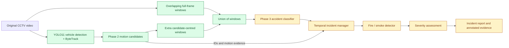

# Pipeline from ByteTrack onward

## Goal and boundary

The handoff from tracking to accident classification should favor **recall**: it is acceptable to send extra video windows to the classifier, but a missing track or a missed motion rule must not be the only reason a scene is skipped. No model can guarantee zero accident false negatives. The concrete guarantee in the current Phase 3 preparation step is narrower: **every decodable source frame appears in at least one full-frame classifier input window**.



| Step | Input and output | State |
| --- | --- | --- |
| ByteTrack | Original video to vehicle IDs, boxes, trails and `tracks.csv` | Implemented |
| Motion proposals | Tracks to candidate times, pairs and regions | Implemented; heuristic and pair-only |
| Full-frame and candidate windows | Original video plus optional `candidates.json` to MP4 windows and `manifest.json` | Implemented in `src/phase3/prepare_windows.py` |
| Accident classifier | Every window to accident probability and, if available, a collision region | Planned; requires a model trained for accident/normal clips |
| Incident manager | Window decisions to one event with start/end, confidence, involved IDs and cooldown | Planned |
| Fire/smoke and severity | Confirmed event region to fire/smoke evidence and a calibrated severity level | Planned |

## Recall-first handoff

1. Keep the **original video** as the classifier input. Do not classify only cropped tracked vehicles: a collision may be small, occluded, or involve an untracked object.
2. Create overlapping 4-second full-frame windows every 2 seconds. This path runs even when `tracks.csv` or `candidates.json` is empty.
3. Add windows centred on Phase 2 candidate and decision times. These prioritize likely events and preserve surrounding context; they never replace the full-frame path.
4. Run the accident model at a threshold chosen on a labeled validation set for high event recall. A low threshold will increase false positives, which the next stage can review.
5. Merge overlapping positive windows into one incident. Match accident regions to ByteTrack boxes when possible; retain the event when IDs are missing.
6. Evaluate **event-level recall**, false alarms per hour, detection latency and performance on single-vehicle, occluded and small-object crashes. Track failures and corrupt inputs separately.

The current Phase 2 scorer needs two tracked vehicles and a score threshold, so it cannot be the sole gate for Phase 3. Its regions use coordinates from video resized to 960 pixels wide; convert those coordinates before cropping the original video. The Phase 3 preparation currently exports full frames and does not crop regions.

## Model choices

| Stage | Recommended starting model | Why and condition |
| --- | --- | --- |
| Accident confirmation | Fine-tuned [VideoMAE video classifier](https://huggingface.co/docs/transformers/main/tasks/video_classification) on accident **and normal** CCTV windows | Uses motion across frames. The published generic checkpoint does not itself provide an accident class; fine-tuning and validation are required. |
| Faster CPU prototype | Fine-tuned [X3D-XS video classifier](https://pytorch.org/hub/facebookresearch_pytorchvideo_x3d/) | Smaller video model to compare with VideoMAE when CPU latency matters; also needs accident/normal training clips. |
| Collision localization | Fine-tuned [YOLO12n detector](https://docs.ultralytics.com/models/yolo12) or a similarly small YOLO detector | Provides a collision box for the incident manager. Official COCO weights do **not** have an accident class; custom annotated collision boxes and training are required. |
| Fire and smoke | A separately fine-tuned small YOLO detector | Localizes flames/smoke in confirmed incident frames. Require persistence across multiple frames before reporting fire. |
| Severity | A labeled, calibrated classifier using confirmed collision, fire and scene features | Severity labels and evaluation are needed before reporting Low/Moderate/High/Critical as predictions. |

For the first working demo, start with **one** fine-tuned accident/normal video classifier. Add a collision detector when region annotations are available. The current collection is accident-only, and two uploaded files (`54_1.mp4` and `74_2.mp4`) are Git LFS pointer text files rather than video data. Normal clips and clean labels are still needed to train and measure false negatives.

## Run the implemented preparation stage

After running Phases 1 and 2 for one source video:

```bash
.venv/bin/python -m src.phase3.prepare_windows \
  --input tests/clips/accident_tbone.mp4 \
  --candidates outputs/phase2/candidates.json
```

For direct classifier coverage without motion candidates:

```bash
.venv/bin/python -m src.phase3.prepare_windows \
  --input tests/clips/accident_tbone.mp4
```

The default output is `outputs/phase3/<source-video-name>/`, containing MP4 windows and `manifest.json`. This stage prepares classifier inputs; it does not label them as accidents.
